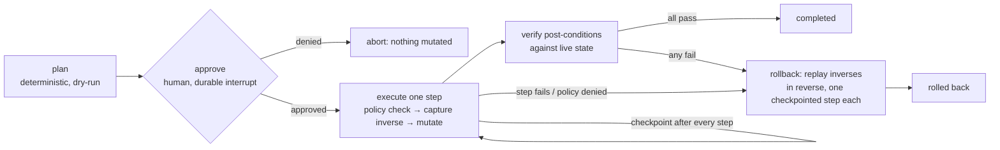

# BlastRadius

**An infrastructure remediation agent with a blast radius of zero.**

Anyone can prompt an LLM into calling cloud APIs. The hard part — the part
that decides whether an autonomous agent may touch real infrastructure — is
the execution shell around it. BlastRadius is that shell:

1. **PLAN** — a deterministic planner produces a structured, reviewable
   dry-run plan before anything mutates.
2. **APPROVE** — nothing mutating runs without an explicit human approval
   of that exact plan (LangGraph `interrupt()`, durable across processes).
3. **EXECUTE** — one step at a time, each step its own LangGraph
   super-step, checkpointed to SQLite. Kill the process mid-run and a
   fresh process resumes exactly where the checkpoint left off.
4. **VERIFY** — post-conditions are checked against live cloud state,
   never against the agent's own claims.
5. **ROLLBACK** — every mutating step records its inverse from live
   pre-state at execution time. A failed verification (or a failed step)
   replays the inverses in reverse order and restores the original state.
6. **SCOPED IDENTITY + AUDIT** — every call is checked against a
   least-privilege, IAM-style policy scoped per scenario (default deny,
   tag conditions), and every event lands in an audit log formatted as
   compliance evidence: timestamp, actor, action, resource, approved-by,
   result.

The planner is deliberately deterministic — no LLM, no API keys, no
network calls. The intelligence on display is the safety engineering,
which is the part production agent roles actually hire for.

The "cloud" is [moto](https://github.com/getmoto/moto) (mock AWS). For the
demo and end-to-end tests it runs as a **separate server process**, so the
cloud genuinely outlives the agent — `kill -9` is a real crash, not a
simulation of one.

## The demo

```bash
python3 -m venv .venv && .venv/bin/pip install -r requirements.txt
.venv/bin/pip install -e .
bash scripts/demo_kill_resume.sh
```

**Part 1 — idle-remediation (happy path).** The planner finds two orphaned
volumes and an idle instance, and deliberately leaves a protected volume
and an attached volume alone:

```
=== APPROVAL REQUEST — run demo-idle (idle-remediation) ===
Plan (dry-run — nothing has mutated yet):
  1. [delete_volume] Delete unattached volume orphan-data (vol-37d0e56c49ee6ed77, 20 GiB gp3)
  2. [delete_volume] Delete unattached volume orphan-scratch (vol-171c6736791eea44f, 8 GiB gp2)
  3. [stop_instance] Stop idle instance batch-worker (i-1a3b25fb87a726495)
Findings (inspected, deliberately untouched):
  - volume protected-archive (vol-e354d62aa85135b0e): unattached but tagged protected=true — left alone
  ...
run status: completed        (verification: 4/4 checks passed)
```

**Part 2 — failed-deployment: killed mid-run, resumed, rolled back.**
A `checkout-api` rollout to v2.0 died halfway: node-2 is stopped on v1.0,
node-3 is running but `health=failed` with a persistent `fault=bad-disk`
marker. The agent starts with a 3-second delay before each mutation; after
two steps are durably checkpointed, the script kills it with `kill -9`:

```
--- cloud state at the moment of the crash (node-2 fixed, node-3 untouched) ---
  instance checkout-api-2: state=running version=2.0 health=unknown
  instance checkout-api-3: state=running version=2.0 health=failed
--- checkpoint state a fresh process would see ---
{ "run_id": "demo-crash", "status": "executing", "step_index": 2,
  "plan_steps": 6, "approved": true, "next_nodes": ["execute"] }

### resuming with a fresh process (no step delay)
run demo-crash: resuming from checkpoint (step_index=2) ...
run status: rolled_back
```

The resumed run finishes the plan — but node-3's health gate refuses to
clear a persistent fault, so **verification fails** (execution succeeded;
the post-condition didn't hold), and every executed step is rolled back:

```
... event=step_applied | action=health_check | result=health_not_cleared | detail=instance ...: persistent fault 'bad-disk' present — health left as 'failed'
... event=verify_check | result=FAIL | detail=checkout-api-3 is healthy: expected healthy, actual failed
... event=verify_failed | result=failed | detail=8/9 checks passed
... event=rollback_step | action=restore_tags | detail=tags on ... restored to {'version': '1.0'}, removed []
... event=rollback_step | action=stop_instance | detail=instance ...: running -> stopped
... event=run_finished | result=rolled_back | detail=6 step(s) executed
```

The demo ends with proof, not assertion — the final snapshot is compared
resource-for-resource, tag-for-tag against the initial one:

```
--- proof: initial vs final snapshot ---
snapshots are IDENTICAL
DEMO OK — killed mid-run, resumed from checkpoint, verification failed, full rollback, state identical.
```

Full unedited transcript: [docs/demo-transcript.txt](docs/demo-transcript.txt).

## How the safety shell works



Key design decisions:

- **Per-step super-steps.** The execute node applies exactly one plan step
  and returns, so LangGraph persists the state — including that step's
  recorded inverse — before the next step begins. A crash can lose at most
  the step in flight, and step application is written to be idempotent
  where the cloud API allows (e.g. starting a running instance is a
  no-op success).
- **Inverses are data, computed at execution time.** The planner never
  guesses how to undo a step. Before mutating, the executor reads the
  resource's live pre-state: a tag change records the previous values
  (and which keys were absent), a volume deletion records the full spec
  (size, type, AZ, tags), a stop records a start.
- **Policy is checked on the way back too.** Rollback actions pass through
  the same least-privilege policy as forward actions.
- **Verification reads live state only.** The verifier never consults the
  plan, the audit log, or the agent's step results — it re-describes the
  cloud and checks post-conditions.

## Scenarios

| Scenario | Starting mess | Plan | Ending |
|---|---|---|---|
| `idle-remediation` | 2 orphaned volumes, 1 idle instance; traps: a `protected=true` volume, an attached volume | delete the orphans, stop the idle instance | verification passes → `completed` |
| `failed-deployment` | `checkout-api` rollout to v2.0 half-applied: node-2 stopped on v1.0, node-3 unhealthy with a persistent fault | start + retag + health-gate node-2; restart + health-gate node-3 | node-3's health gate refuses → verification fails → full rollback, state byte-identical to the start |

## Least-privilege policies

Each scenario runs under its own IAM-style policy in
[`policies/`](policies/). The evaluator mirrors IAM semantics at a small
scale: explicit Deny beats Allow, Action/Resource are glob patterns,
statements can carry tag conditions, and anything not explicitly allowed
is denied. Examples:

- `idle-remediation` may `ec2:DeleteVolume` **only** when the volume's
  `protected` tag is `"false"`, and may `ec2:StopInstances` only when the
  instance is tagged `idle=true`. It has no terminate permission at all.
- `deployment-recovery` may start/stop/retag **only** instances tagged
  `service=checkout-api`. The same action against any other service is
  denied — the agent cannot wander off its assignment, and a denial fails
  the run into rollback rather than escalating.

## CLI

```bash
blastradius seed    --scenario failed-deployment     # create the mess
blastradius run     --scenario failed-deployment --run-id demo-1   # plan + pause for approval
blastradius approve --run-id demo-1                  # grant approval, execute
blastradius resume  --run-id demo-1                  # re-attach after a crash
blastradius status  --run-id demo-1                  # checkpointed state
blastradius audit   --run-id demo-1                  # compliance-evidence log
blastradius snapshot --out before.json               # dump cloud state
blastradius compare --a before.json --b after.json   # exit 0 iff identical
```

`run` also takes `--interactive` (prompt at the terminal) and
`--auto-approve` — the latter exists only so scripted demos and tests can
run unattended, is labeled as such everywhere it appears (including in the
audit log's `approved_by`), and is never the default.

Runs against a moto server need `BLASTRADIUS_AWS_ENDPOINT` set (see the
demo script); with no endpoint, boto3 targets real AWS endpoints, which is
how the same code would run against a real account — with real credentials
and a policy you have reviewed very carefully.

## Tests

```bash
.venv/bin/python -m pytest tests/ -q     # 17 passed
```

- `test_planner.py` — plan shape for both scenarios: exact steps and
  order, traps reported as findings and never planned, determinism.
- `test_policy.py` — default deny (no terminate, ever), tag conditions,
  per-service scoping.
- `test_inverses.py` — every mutating step records the correct inverse
  from live pre-state; the health gate with a persistent fault mutates
  nothing and records no inverse; the executor refuses a protected volume.
- `test_graph_runs.py` — full graph runs in-process: happy path completes
  and verifies; the failed deployment rolls back to a snapshot **equal**
  to the pre-run snapshot; a denied approval mutates nothing.
- `test_resume.py` — the real thing in subprocesses: moto server + CLI,
  `SIGKILL` after two checkpointed steps, fresh-process resume, rollback,
  snapshot comparison. (This is the demo, asserted.)

## What this demonstrates

- **LangGraph in depth** — state machines, `interrupt()`-based human
  approval, conditional routing, and SqliteSaver durable checkpointing
  used as a crash-recovery mechanism, not a chat-memory toy.
- **Agent safety engineering** — plan/approve/verify/rollback as enforced
  control flow; least-privilege identity per task with tag-scoped
  policies; fail-closed behavior (policy denial or step failure routes to
  rollback, never to retry-with-more-privilege).
- **Auditability** — an append-only evidence log that names the approver
  for every mutation, suitable for change-management review.
- **Cloud operations fluency** — boto3/EC2 semantics, idempotency, and
  state-diffing as a verification tool.

## Honest limitations

- **moto is not AWS.** Moto models EC2 start/stop/tags/volumes faithfully
  enough for this shell, but real AWS adds eventual consistency, richer
  instance-state transitions, IAM evaluation against real ARNs and
  principals, and failure modes moto doesn't have. The shell's structure
  carries over; the policy documents would need real-account review.
- **The planner is deterministic by design.** It encodes two runbooks.
  The contribution here is the execution shell — an LLM planner could be
  dropped in *behind* the same plan/approve/verify/rollback gates, which
  is exactly where an LLM belongs: proposing, never directly mutating.
- **The fault in scenario (b) is scenario data.** Node-3's persistent
  `fault=bad-disk` tag stands in for a hardware fault a health checker
  would report. The health gate honoring it — and verification catching
  the unmet post-condition — is real behavior, not scripted output.
- **Checkpoint atomicity window.** LangGraph checkpoints at step
  boundaries; a kill between a cloud mutation and its checkpoint write
  would replay that step on resume. Steps are therefore written to be
  idempotent where the API allows, but a production system would add
  idempotency tokens / a transactional outbox around each mutation.
- **A recreated volume gets a fresh ID.** The delete-volume inverse
  restores size, type, AZ, and tags exactly, but AWS never reissues a
  volume ID — snapshot equality after a volume rollback is therefore
  semantic, not ID-based. (The demo's rollback proof uses the deployment
  scenario, where every inverse restores the same resource.)
- **`--auto-approve` is a demo convenience**, labeled as such in output
  and in the audit log. The default path always stops for a human.

## Layout

```
blastradius/
  graph.py       the LangGraph shell: plan → approve → execute → verify → rollback
  planner.py     deterministic planners + verifiers (live-state post-conditions)
  actions.py     executor: policy check, inverse capture, mutation
  policy.py      IAM-style policy evaluator (globs, tag conditions, default deny)
  scenarios.py   seeders for the two broken starting states
  cloud.py       boto3 factory, snapshots, snapshot diffing
  audit.py       append-only compliance-evidence log
  cli.py         seed / run / approve / resume / status / audit / snapshot / compare
policies/        one least-privilege policy document per scenario
scripts/         demo_kill_resume.sh — the kill -9 / resume / rollback demo
tests/           planner, policy, inverse, graph-run, and subprocess resume tests
docs/            demo-transcript.txt — full unedited demo output
```
